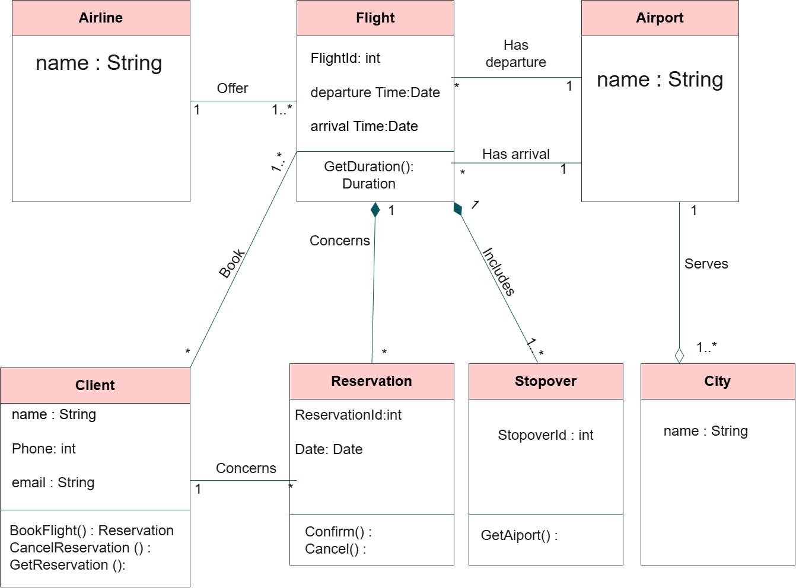

# Class Diagram

## Description
This exercise focuses on designing a UML class diagram to manage flights booked through an agency

## Class Diagram
The following diagram illustrates the classes, their attributes, methods, and relationships.

