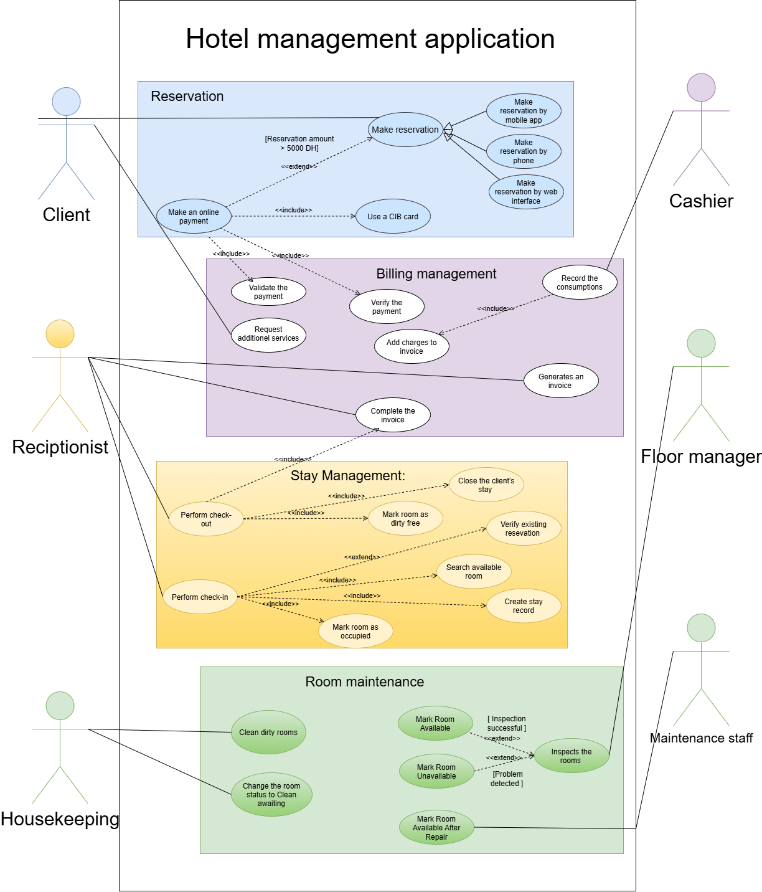

# Exercise 4 – Hotel Management System

## Objective

The objective of this exercise is to identify the actors, external actions, and functional boundaries of a hotel management system and represent its functionalities using a UML use case diagram.

## 1. Actors of the System

The main actors interacting with the system are:

- **Client:** Makes reservations, performs online payments, and requests additional services.
- **Receptionist:** Manages reservations, room availability, check-in, check-out, and invoices.
- **Cashier:** Records additional service consumption and payments.
- **Housekeeping Staff:** Cleans rooms and updates their status.
- **Floor Manager:** Inspects rooms and updates their availability.
- **Maintenance Staff:** Performs repairs on unavailable rooms.
- **Bank Server:** External system responsible for validating online payments.

## 2. Actions Outside the System

The following actions are performed outside the application:

- Making a reservation by phone (the conversation itself).
- Cleaning hotel rooms.
- Inspecting the physical condition of rooms.
- Repairing damaged equipment or facilities.
- Providing additional services such as breakfast, lunch, or dinner.
- Receiving payments.

## 3. Functional Boundaries (Modules)

The system can be divided into the following modules:

- Reservation Management
- Payment Management
- Room Management
- Stay Management
- Billing Management
- Additional Services Management
- Housekeeping Management
- Maintenance Management

## 4. UML Use Case Diagram

