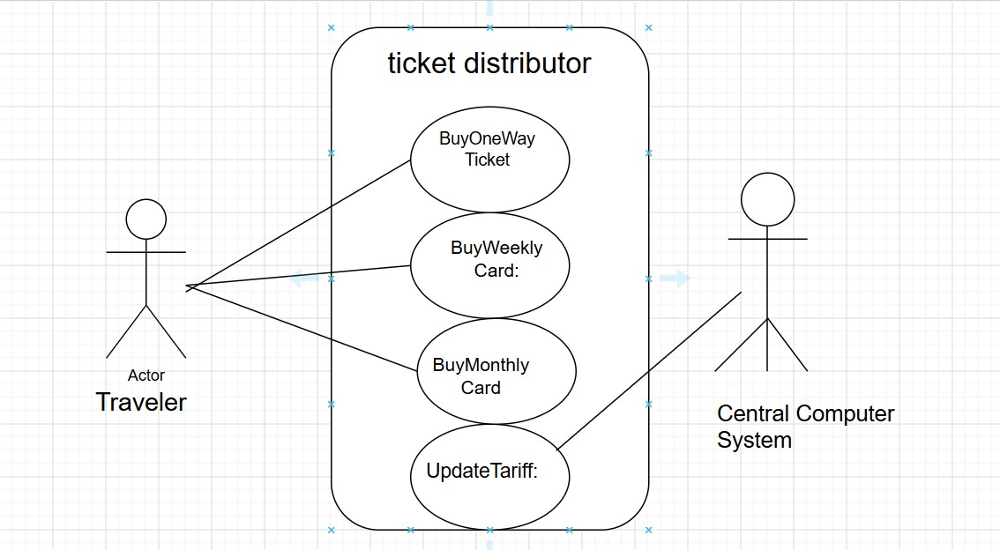
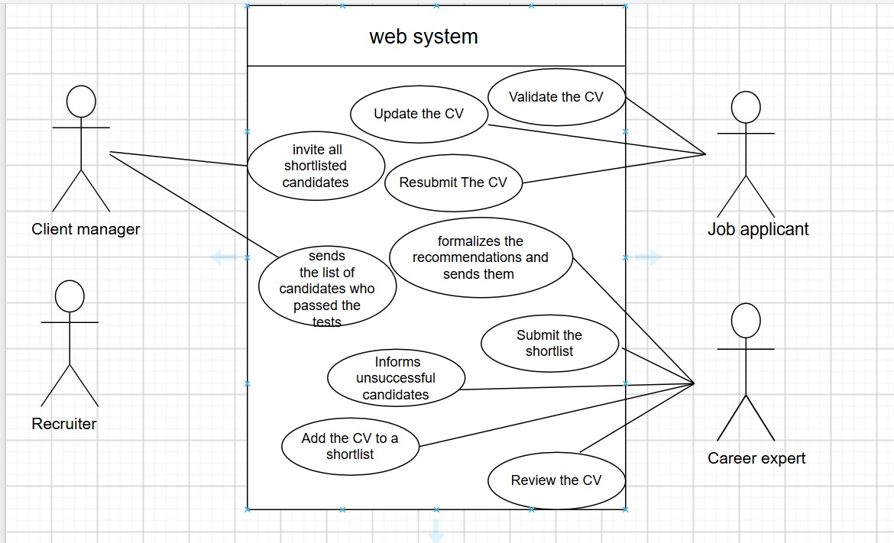
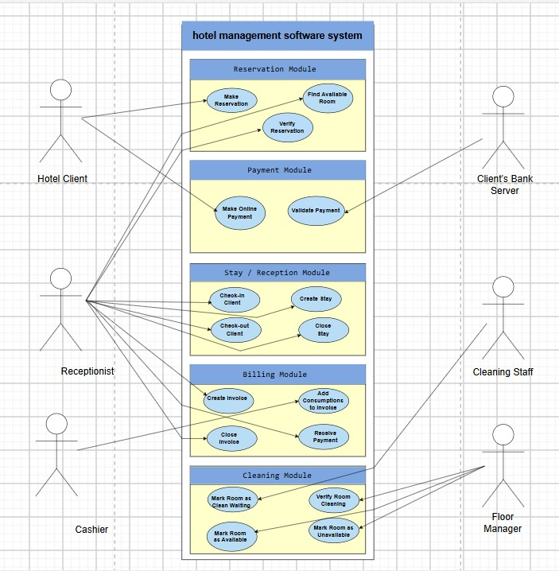

# Requirements Specification Lab

## Objective

The objective of this lab is to understand how to identify and organize system requirements, determine actors and use cases, and represent them using use case diagrams.

## Exercise 1 – Warming Up

### Question 1: Development Time

With a productivity of **100 lines of code per day**:

- Firefox contains approximately **10 million lines of code**.
- Google services contain approximately **2,000 million lines of code**.

Therefore:

**Firefox:**

10,000,000 / 100 = **100,000 days ≈ 274 years**

**Google:**

2,000,000,000 / 100 = **20,000,000 days ≈ 54,795 years**

### Question 2: How can companies manage such large projects?

Large companies can develop huge software systems because they use large development teams, divide the project into smaller modules, and use collaborative tools and automated testing.

### Question 3: Lines of Code and Productivity

Writing more lines of code does not necessarily mean that a developer is more productive. A developer who solves the same problem with 50 clear and efficient lines may be more productive than one who uses 500 lines.

Better productivity indicators include:

- Code quality and maintainability
- Number of completed features
- Number of bugs
- Performance of the solution
- Ability to meet requirements and deadlines

### Question 4: Developers in the AI Era

If AI generates most of the code, human developers will still be responsible for understanding requirements, designing systems, making important decisions, validating AI-generated solutions, solving complex problems, and ensuring software quality.

## Exercise 2 – Train Ticket Distributor

The main actors are:

- **Traveler**
- **Central Computer System**

The main use cases are:

- Buy One-Way Ticket
- Buy Weekly Card
- Buy Monthly Card
- Update Tariff

### Use Case Diagram

## Exercise 3 – Recruitment System

### Functional Requirements

| Functional Requirement | Priority | Estimated Effort |
|---|---|---|
| Allow applicants to create and validate their CV | High | Medium |
| Allow career experts to review CVs and provide recommendations | High | Medium |
| Allow career experts to create and submit candidate shortlists | High | Medium |
| Allow client managers to create and manage automated tests | High | High |
| Send matching job announcements to users weekly | Medium | Medium |

### Use Case Diagram

The system is divided into the modules described in the exercise, such as **CV Builder**, **Orientation**, and **Tests**.

## Exercise 4 – Hotel Management System

### 1. Actors

The main actors are:

- Hotel Client
- Receptionist
- Cashier
- Cleaning Staff
- Floor Manager
- Bank Server
- Maintenance Staff

### 2. Actions Outside the System

Some actions happen outside the software system, for example:

- Making a reservation by phone
- Physically cleaning a room
- Performing maintenance or repairing room damages

### 3. Functional Boundaries

The hotel management system can be divided into functional modules such as:

- Reservation
- Payment
- Reception / Stay Management
- Billing
- Cleaning
- Maintenance

### 4. Use Case Diagram

